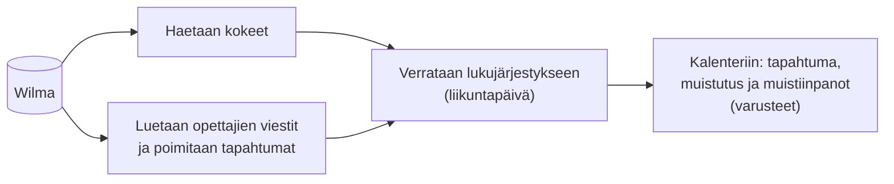
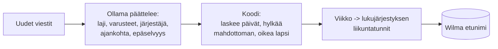
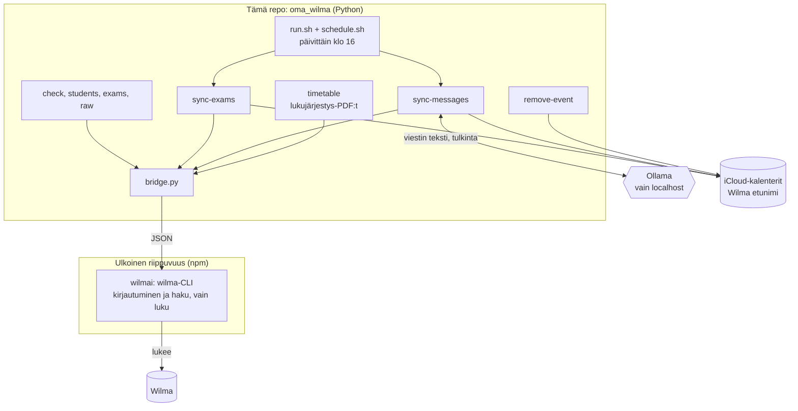

# Wilmaton Wilma

> **Wilma without Wilma** is a small macOS tool for parents that reads Wilma (the Finnish school messaging system) and does
> two separate things:
>
> 1. **Calendar export:** exams and the dates in teachers' messages (gym gear, photo day, trips) go into your iCloud
>    calendar, one calendar per child, with reminders. A local Ollama model interprets the messages, so they never leave
>    your machine.
> 2. **Printable timetables:** each child's weekly timetable as an A4 colouring page, with reminders for the child
>    (gym clothes, snack, late start).
>
> Unofficial; not affiliated with Visma. The rest of the docs are in Finnish.

Nimi on sanaleikki: oleelliset näkyvät kalenterissa, joten Wilmaa tarvitsee avata vähemmän. Koodi ja komennot ovat silti `oma_wilma`.

Wilmaton Wilmassa on **kaksi erillistä toimintoa**. Ne käyttävät samaa Wilma-hakua, mutta muuten ne ovat toisistaan
riippumattomia: voit käyttää vain toista.

| | Mitä tekee | Komento | Tarvitsee |
|---|---|---|---|
| **1. Kalenterivienti** | Wilman kokeet ja opettajien viesteissä kerrotut asiat iCloud-kalenteriin muistutuksineen, yksi kalenteri lasta kohden | `scripts/run.sh` (voi ajastaa päivittäiseksi) | Ollama, iCloud-kalenterit |
| **2. Lukujärjestykset** | Jokaiselle lapselle tulostettava lukujärjestys väritettävällä kuvalla ja muistutusmerkeillä | `scripts/timetable.sh` (käsin, kun tarvitaan) | Google Chrome |

Hyvä tietää: Wilmaa vain luetaan, mutta viestin avaaminen voi merkitä sen Wilmassa luetuksi. Tekoäly erehtyy joskus, joten tärkeät asiat kannattaa tarkistaa alkuperäisestä viestistä.

**Epävirallinen työkalu.** Wilman käyttöehtoja ei ole varmistettu tälle käytölle; käytä omalla vastuullasi ja omilla tunnuksillasi, vain omien lasten tietoihin.

## 1. Kalenterivienti

Vie Wilman **kokeet** ja **opettajien viesteissä kerrotut asiat** (liikunnan varusteet, kuvauspäivä, retki, tapahtumat)
iCloud-kalenteriisi muistutuksineen: yksi kalenteri `Wilma <etunimi>` lasta kohden. Viestit tulkitsee **vain paikallinen
Ollama** (omalla koneella pyörivä tekoäly), eli viestin sisältö ei lähde koneelta.

### Miksi

Wilmassa on kaksi paikkaa, joita ei tule säännöllisesti kurkistettua. Kokeet löytyvät omasta Kokeet-osiostaan. Opettajien viesteistä moni
koskee jotain tiettyä päivää ("ensi viikolla luistelu, ota luistimet", "kuvauspäivä torstaina") ja hukkuu muun joukkoon. Tämä työkalu vie
ne puolestasi kalenteriin, jota katsot muutenkin.

- **Kaikki yhdessä paikassa:** kokeet ja viesteissä kerrotut asiat näkyvät kalenterissa.
- **Muistutus ajoissa:** kokeesta kaksi päivää etukäteen, varusteista edellisenä iltana. Otsikossa on tärkein (esim. `🎽Luistelu: luistimet`), loput muistiinpanoissa.
- **Liikunta osuu oikealle päivälle:** kun viesti sanoo vain "ensi viikolla", päivä haetaan lapsen lukujärjestyksen liikuntatunneilta.
- **Ei kuittausta lapsi kerrallaan:** Wilmassa sama viesti pitää kuitata käsin erikseen jokaiselle lapselle. Täällä usealle lapselle tuleva viesti käsitellään kerran.
- **Yksityinen:** viestit tulkitsee [Ollama](https://ollama.com), ohjelma, joka ajaa tekoälymallin (tässä Googlen Gemma) kokonaan omalla koneellasi. Malli ladataan kerran, minkä jälkeen tulkinta ei tarvitse nettiyhteyttä. Viestin teksti ei lähde koneelta; iCloud-kalenteriin menee vain tulkittu tapahtuma.



**Kokeiden vienti kalenteriin on vielä testaamatta oikealla datalla:** kokeiden haun kuiva-ajo on tehty (Wilma vastasi ilman virheitä), mutta kokeita ei ole ollut tulossa. Odotamme koeviikkoa. Siihen asti kokeiden osuus on testattu vain keksityllä datalla.

### Mitä kalenteriin tulee

Otsikko mahtuu puhelimen näytölle (laji ja tärkein varuste); koko tieto, myös valinnaiset varusteet kuten maila, on muistiinpanoissa.

| Laji | Esimerkki | Muistutus |
|---|---|---|
| 📝 Koe | `📝Koe: Matematiikka – Murtoluvut` | 2 pv ennen |
| 🎽 Liikunta | `🎽Luistelu: luistimet` | edellisenä iltana |
| 📸 Kuvaus, 🚌 Retki, 📌 Tapahtuma | `📸Kuvaus: kuvauspäivä` | edellisenä iltana |
| 👪 Koulun vanhempainilta | `👪Vanhempainilta` | 3 pv ja 1 pv ennen |
| ℹ️ Tiedoksi (ulkopuolinen järjestäjä) | `ℹ️Tiedoksi: Seurakunta – ilta` | ei |

`⚠️` lajin emojin jälkeen tarkoittaa, että malli piti asiaa epäselvänä (syy on kuvauksessa). Tapahtumat ovat koko päivän tapahtumia.

### Miten viestit tulkitaan

Viestit ovat vapaamuotoisia, joten **malli päättelee merkityksen ja koodi hoitaa hallinnan**.



- **Malli:** luokka, otsikko, varusteet (pakolliset, valinnaiset, kielletyt), onko järjestäjä koulu, ajankohta (viikonpäivä, päiväys, viikko) ja epäselvyys. Lapsen omat viimeaikaiset merkinnät (poissaolot) annetaan sille, jotta se ratkaisee koskeeko ehdollinen viesti juuri tätä lasta.
- **Koodi:** laskee päivät viikosta ja viikonpäivästä, hylkää mahdottoman (ei ajankohtaa, mennyt, yli 90 pv), hyväksyy tarkan päivän vain jos viesti mainitsee sen, ja varmistaa oikean lapsen kalenterin.
- **Viikkoon sidottu liikunta** sijoitetaan oppilaan lukujärjestyksen liikuntatunneille; viestissä nimetty päivä menee sille päivälle.
- **Sisarukset:** sama viesti usealle lapselle käsitellään kerran ja menee `shared_priority`-listan ensimmäiselle. Lapsia voi olla kolme, neljä tai useampi: listaan voi laittaa kaikki, ja tapahtuman otsikossa on aina sama 👬-merkki sekä kuvauksessa lista muista lapsista, joille viesti tuli.
- **Toisto ei tuplaa:** tapahtuman tunniste on oppilas, laji ja päivä; saman päivän eri viestit yhdistetään, ja uudelleenkäsitelty viesti korvaa oman vanhan osuutensa.

## 2. Lukujärjestykset

Hakee Wilmasta ensi viikon tunnit ja tekee jokaiselle lapselle oman A4-lukujärjestyksen (vaaka) PDF:ksi kansioon
`data/lukujarjestykset/`. Ylhäällä on lapsen nimi isoin kirjaimin, ja reunoilla on mustavalkoinen kuva, jonka lapsi voi
värittää. Teemoja on kaksi: `green` (palikkamaailma: soturi, laiva, lammas, puut) ja `heart` (sydämet, tähdet, sateenkaari
ja yksisarviset).

Lukujärjestykseen saa valinnoilla lapselle muistutuksia:

- 🎽 liikuntapäivät: liikuntavaatteet mukaan
- 🍎 välipalapäivät, jotka annat itse
- ☀️ / 🌙 alkaako koulu aamulla vai vasta ruokailun jälkeen
- ruokailu tuntien välissä, ja tukiopetuksen voi jättää pois

```
scripts/timetable.sh --theme heart --no-support --meals --pe-emoji --start-emoji --snack wed
```

Ohjeet ja kaikki valinnat: **[docs/lukujarjestys.md](docs/lukujarjestys.md)**.

## Rakenne

Wilma-haun tekee **ulkoinen kirjasto**, [wilmai](https://github.com/aikarjal/wilmai) ja sen `wilma`-CLI. Se asennetaan npm-riippuvuutena,
sen koodia ei ole tässä repossa, ja vain `bridge.py` kutsuu sitä.



| Riippuvuus | Mihin | Asennus |
|---|---|---|
| wilmai / wilma-CLI | Wilma-haku | `npm install` |
| pyobjc (EventKit) | kalenteriin kirjoitus | `pip install -r requirements.txt` |
| Ollama | viestien tulkinta | ollama.com, `ollama pull gemma4:12b` |

**Ollamasta:** asenna Ollama-sovellus (ollama.com) ja lataa malli kerran: `ollama pull gemma4:12b` (7,7 Gt levyä; testattu 16 Gt:n muistilla). Sovellus pitää
palvelimen käynnissä taustalla; ilman sovellusta sen voi käynnistää käsin: `ollama serve`. Ajastetussa ajossa `scripts/run.sh` käynnistää palvelimen
itse, jos se ei vastaa, joten erillistä automaattista käynnistystä ei tarvita.

## Asennus

Tarvitset: macOS, [Node.js](https://nodejs.org) 20.18.1 tai uudempi ja Python 3.11 tai uudempi. Kalenterivientiin lisäksi
Ollama ja iCloud-kalenterit, lukujärjestyksiin Google Chrome.

```
git clone https://github.com/Gerlitek/wilmaton-wilma.git && cd wilmaton-wilma
npm install
cp .env.example .env                # WILMA_TENANT ja WILMA_USERNAME
cp config.example.toml config.toml  # henkilökohtaiset asetukset (lapset, järjestäjät, muistutukset)
python3 -m venv .venv && .venv/bin/pip install -r requirements.txt
security add-generic-password -s wilma -a password -w          # salasana Keychainiin (kysyy arvon)
security add-generic-password -s wilma -a totp-secret -w       # vain kaksivaiheisella; avain, ei 6 numeron koodi
```

Kalenterivientiä varten luo Kalenterit-sovelluksessa (iCloud) kalenteri jokaiselle lapselle nimellä `Wilma <etunimi>`. Työkalu ei luo niitä, ja jos jokin
puuttuu, ajo keskeytyy ennen kirjoitusta. Tarkistus: `python3 -m oma_wilma check`.

## Käyttö

**1. Kalenterivienti**

```
scripts/run.sh [--dry-run]                                 koko putki: kokeet, sitten viestit
scripts/schedule.sh on | off | status | test               päivittäinen ajastus (launchd)
.venv/bin/python -m oma_wilma sync-exams [--dry-run]      kokeet kalentereihin
.venv/bin/python -m oma_wilma sync-messages [--dry-run]   viestit kalentereihin (--days N, --student X, --again, --explain)
.venv/bin/python -m oma_wilma remove-event TUNNISTE       poistaa oman tapahtuman ([wilma:...] muistiinpanoissa)
```

`--dry-run` ei kirjoita mitään; viesteille se kertoo vain määrän. `--again --explain` käsittelee viestit uudelleen ja näyttää, mitä malli
ehdotti ja miksi jokin hylättiin (ei viestin tekstiä). **Viestin avaaminen voi merkitä sen Wilmassa luetuksi.**

**2. Lukujärjestykset**

```
scripts/timetable.sh [valinnat]                            lukujärjestykset PDF:ksi (data/lukujarjestykset/)
scripts/timetable.sh --help                                kaikki valinnat
```

**Yhteiset (vain luku)**

```
python3 -m oma_wilma check | students | exams | raw ...   kirjautumisen tarkistus ja haku
```

## Asetukset ja turvarajat

`config.toml` (ei Gitissä): `[ollama]` osoite ja malli, `[messages]` `shared_priority`, `external_organizers`, `pe_subject_words`, `[reminders]`
kellonaika ja päivät, `[timetable]` ruokatauko, tukiopetuksen sanat ja aineiden nimet. Salasanat ovat Keychainissa.

- Ollama hyväksytään vain osoitteesta `localhost`; viestin tekstiä ei kirjata mihinkään.
- Kalenteriin kirjoitetaan vain `Wilma `-alkuisiin kalentereihin, ja jokainen tapahtuma tarkistetaan oikean lapsen kalenteriin ennen kirjoitusta.
- `.env`, `config.toml`, `data/` (myös lukujärjestys-PDF:t) ja `private/` (omat muistiinpanot ja yksityisyystarkistuksen sanalista
  `private/private-terms.txt`: lasten nimet ym.) eivät mene Gitiin. Aja ennen pushia `python3 scripts/privacy_check.py` (`--history` myös historia).

## Ylläpito

```
python3 -m unittest discover -s tests -t .      testit, kalenteri ja lukujärjestys (eivät koske Wilmaan, kalenteriin, Ollamaan tai Chromeen)
scripts/update-wilmai.sh [latest]               päivittää wilmai-CLI:n ja ajaa testit
```

Koodin rakenne (`oma_wilma/`), kalenteri ja lukujärjestys erillään; ne jakavat vain yhteiset osat:

| Kansio | Mitä | Moduulit |
|---|---|---|
| `oma_wilma/` | yhteiset: asetukset, Wilma-haku, oma tietomuoto, komentorivi | `config`, `bridge`, `models`, `__main__` |
| `oma_wilma/calendar_sync/` | kalenteri: kokeet ja viestit iCloud-kalentereihin | `sync_exams`, `sync_messages`, `messages`, `prompt`, `notices`, `when`, `notice_events`, `events`, `calendars`, `calendar_export` ym. |
| `oma_wilma/timetable/` | lukujärjestys: tunnit PDF:ksi teemalla | `grid` (ruudukko), `pdf` (sivu ja PDF), `themes` (teemat) |

## Windows (ei testattu)

Työkalu on tehty macOS:lle eikä sitä ole testattu Windowsissa, eikä sitä aiota testata. Karkea suunta niille, jotka haluavat kokeilla:
Wilma-haku (wilmai), Python-koodi ja Ollama toimivat sellaisinaan myös Windowsissa. macOS-sidonnaiset osat pitää korvata:
kalenteriin kirjoitus (`calendar_sync/calendar_export.py`, EventKit/pyobjc; esim. Outlook tai Google Calendar -rajapinta tai `.ics`-tiedostot),
salasanat (macOS Keychain; esim. Windowsin Credential Manager tai ympäristömuuttujat) ja ajastus (`launchd`; esim. Windowsin
Tehtävien ajoitus (Task Scheduler), jolla ajetaan `scripts/run.sh`:n vastine).

## Lisenssi

[MIT](LICENSE). Wilma-haun tekee [wilmai](https://github.com/aikarjal/wilmai) (`@wilm-ai/wilma-cli`, MIT, © Wilm.ai), joka asennetaan
npm-riippuvuutena eikä sisälly tähän repoon.
