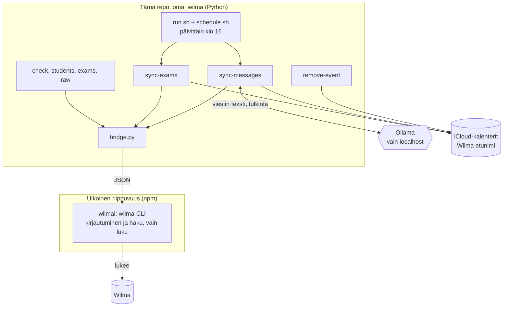
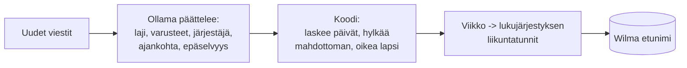

# wilma

Vie Wilman **kokeet** ja **opettajien viesteissä kerrotut asiat** (liikunnan varusteet, kuvauspäivä, retki, tapahtumat) lapsen
omaan iCloud-kalenteriin `Wilma <etunimi>` muistutuksineen. Wilmaa vain luetaan. Viestit tulkitsee **vain paikallinen Ollama**,
eli viestin sisältö ei lähde koneelta. Tehty macOS:lle yksityiskäyttöön; ei liity Vismaan tai Wilmaan.

## Rakenne

Wilma-haun tekee **ulkoinen kirjasto**, [wilmai](https://github.com/aikarjal/wilmai) ja sen `wilma`-CLI. Se asennetaan npm-riippuvuutena,
sen koodia ei ole tässä repossa, ja vain `bridge.py` kutsuu sitä.



| Riippuvuus | Mihin | Asennus |
|---|---|---|
| wilmai / wilma-CLI | Wilma-haku | `npm install` |
| pyobjc (EventKit) | kalenteriin kirjoitus | `pip install -r requirements.txt` |
| Ollama | viestien tulkinta | ollama.com, `ollama pull qwen3:8b` |

## Asennus

```
npm install
cp .env.example .env                # WILMA_TENANT ja WILMA_USERNAME
cp config.example.toml config.toml  # henkilökohtaiset asetukset (lapset, järjestäjät, muistutukset)
python3 -m venv .venv && .venv/bin/pip install -r requirements.txt
security add-generic-password -s wilma -a password -w          # salasana Keychainiin (kysyy arvon)
security add-generic-password -s wilma -a totp-secret -w       # vain kaksivaiheisella; avain, ei 6 numeron koodi
```

Luo Kalenterit-sovelluksessa (iCloud) kalenteri jokaiselle lapselle nimellä `Wilma <etunimi>`. Työkalu ei luo niitä, ja jos jokin
puuttuu, ajo keskeytyy ennen kirjoitusta. Tarkistus: `python3 -m oma_wilma check`.

## Käyttö

```
.venv/bin/python -m oma_wilma sync-exams [--dry-run]      kokeet kalentereihin
.venv/bin/python -m oma_wilma sync-messages [--dry-run]   viestit kalentereihin (--days N, --student X, --again, --explain)
.venv/bin/python -m oma_wilma remove-event TUNNISTE       poistaa oman tapahtuman ([wilma:...] muistiinpanoissa)
python3 -m oma_wilma check | students | exams | raw ...   haku, vain luku

scripts/run.sh [--dry-run]                                 koko putki: kokeet, sitten viestit
scripts/schedule.sh on | off | status | test               päivittäinen ajastus (launchd)
```

`--dry-run` ei kirjoita mitään; viesteille se kertoo vain määrän. `--again --explain` käsittelee viestit uudelleen ja näyttää, mitä malli
ehdotti ja miksi jokin hylättiin (ei viestin tekstiä). **Viestin avaaminen voi merkitä sen Wilmassa luetuksi.**

## Mitä kalenteriin tulee

Otsikko mahtuu puhelimen näytölle (laji ja tärkein varuste); koko tieto, myös valinnaiset varusteet kuten maila, on muistiinpanoissa.

| Laji | Esimerkki | Muistutus |
|---|---|---|
| 📝 Koe | `📝Koe: Matematiikka – Murtoluvut` | 2 pv ennen |
| 🎽 Liikunta | `🎽Luistelu: luistimet` | edellisenä iltana |
| 📸 Kuvaus, 🚌 Retki, 📌 Tapahtuma | `📸Kuvaus: kuvauspäivä` | edellisenä iltana |
| 👪 Koulun vanhempainilta | `👪Vanhempainilta` | 3 pv ja 1 pv ennen |
| ℹ️ Tiedoksi (ulkopuolinen järjestäjä) | `ℹ️Tiedoksi: Seurakunta – ilta` | ei |

`⚠️` lajin emojin jälkeen tarkoittaa, että malli piti asiaa epäselvänä (syy on kuvauksessa). Tapahtumat ovat koko päivän tapahtumia.

## Miten viestit tulkitaan

Viestit ovat vapaamuotoisia, joten **malli päättelee merkityksen ja koodi hoitaa hallinnan**.



- **Malli:** luokka, otsikko, varusteet (pakolliset, valinnaiset, kielletyt), onko järjestäjä koulu, ajankohta (viikonpäivä, päiväys, viikko) ja epäselvyys. Lapsen omat viimeaikaiset merkinnät (poissaolot) annetaan sille, jotta se ratkaisee koskeeko ehdollinen viesti juuri tätä lasta.
- **Koodi:** laskee päivät viikosta ja viikonpäivästä, hylkää mahdottoman (ei ajankohtaa, mennyt, yli 90 pv), hyväksyy tarkan päivän vain jos viesti mainitsee sen, ja varmistaa oikean lapsen kalenterin.
- **Viikkoon sidottu liikunta** sijoitetaan oppilaan lukujärjestyksen liikuntatunneille; viestissä nimetty päivä menee sille päivälle.
- **Sisarukset:** sama viesti usealle lapselle käsitellään kerran ja menee `shared_priority`-listan ensimmäiselle.
- **Toisto ei tuplaa:** tapahtuman tunniste on oppilas, laji ja päivä; saman päivän eri viestit yhdistetään, ja uudelleenkäsitelty viesti korvaa oman vanhan osuutensa.

## Asetukset ja turvarajat

`config.toml` (ei Gitissä): `[ollama]` osoite ja malli, `[messages]` `shared_priority`, `external_organizers`, `pe_subject_words`, `[reminders]`
kellonaika ja päivät. Salasanat ovat Keychainissa.

- Ollama hyväksytään vain osoitteesta `localhost`; viestin tekstiä ei kirjata mihinkään.
- Kalenteriin kirjoitetaan vain `Wilma `-alkuisiin kalentereihin, ja jokainen tapahtuma tarkistetaan oikean lapsen kalenteriin ennen kirjoitusta.
- `.env`, `config.toml`, `data/` ja `.private-terms.txt` eivät mene Gitiin. Aja ennen pushia `python3 scripts/privacy_check.py` (`--history` myös historia).

## Ylläpito

```
python3 -m unittest discover -s tests -t .      testit (eivät koske Wilmaan, kalenteriin tai Ollamaan)
scripts/update-wilmai.sh [latest]               päivittää wilmai-CLI:n ja ajaa testit
```

Koodin rakenne: `oma_wilma/` (`bridge`, `models`, `sync_exams`, `sync_messages`, `prompt`, `notices`, `when`, `notice_events`, `calendars`, `calendar_export`).
Wilman (Vismän) käyttöehtoja ei ole vielä tarkistettu.
