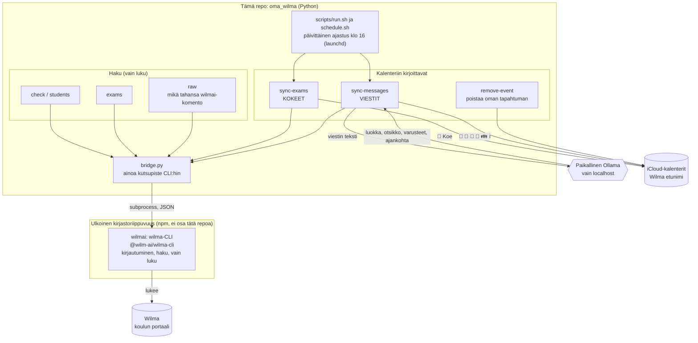
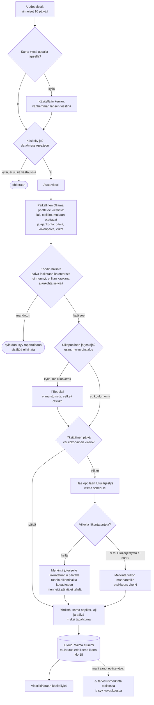

# wilma

Omat Wilma-työkalut koululaisen vanhemmalle. Ne **lukevat** Wilmaa (eivät kirjoita siihen mitään) ja vievät tärkeät
päivät iCloud-kalentereihin: **kokeet** ja **opettajien viesteissä kerrotut asiat** (liikuntatunnin varusteet,
kuvauspäivä, retki, tapahtumat). Jokaisella lapsella on oma kalenteri (`Wilma <etunimi>`), ja muistutus tulee ajoissa.

Viestit tulkitaan **vain paikallisella Ollama-kielimallilla**: viestin sisältö ei lähde koneelta. Malli ymmärtää viestin
kielen ja päättelee itse, mihin päivään tai viikkoon asia viittaa, joten viestissä ei tarvitse olla mitään tiettyä sanaa.
Viikkoon sidotut liikuntailmoitukset **verrataan oppilaan lukujärjestykseen**, ennen kuin merkintä viedään kalenteriin,
jotta se tulee oikeille päiville.

> Tämä on yksityiskäyttöön tehty työkalu macOS:lle. Se ei liity Vismaan tai Wilmaan.

## Toiminnot ja riippuvuudet

Tämä repo sisältää vain `oma_wilma`-työkalun (Python). **Wilma-haku ei ole osa tätä repoa:** sen tekee ulkoinen
[wilmai](https://github.com/aikarjal/wilmai)-kirjasto ja sen `wilma`-komentorivityökalu (CLI), joka asennetaan erillisenä
npm-riippuvuutena (`npm install`, pinnattu tiedostoissa `package.json` ja `package-lock.json`). Sen koodia ei ole kopioitu tänne,
eikä sitä pidä muokata. `oma_wilma/bridge.py` on ainoa paikka, jossa CLI:tä kutsutaan.



| Riippuvuus | Mikä | Asennus | Missä määritelty |
|---|---|---|---|
| **wilmai / wilma-CLI** | Wilma-haku (kirjautuminen, kaksivaiheinen, jäsentimet), ulkoinen kirjasto | `npm install` | `package.json`, `package-lock.json` |
| **pyobjc (EventKit)** | kalenterivienti macOS:llä, vain kirjoittaville komennoille | `pip install -r requirements.txt` | `requirements.txt` |
| **Ollama** | paikallinen kielimalli viestien tulkintaan | ollama.com, `ollama pull <malli>` | `config.toml` |

## Mitä viestille tapahtuu ennen kalenteria

Työnjako: **malli päättää merkityksen, koodi hoitaa hallinnan.** Malli päättelee viestistä kaiken sisällön: mistä asiasta on
kyse, kuka sen järjestää (koulu vai ulkopuolinen), mitä pitää ottaa mukaan (pakolliset, valinnaiset kuten maila, kielletyt),
mihin päivään tai viikkoon se viittaa ("ensi viikolla", "vkot 44 ja 45", "huomenna" ...) ja jos jokin on epäselvää, se sanoo
sen itse. Koodi ei tulkitse kieltä sanalistoilla. Se laskee päivät kalenterista (pieni malli laskee päiviä huonosti),
hylkää mahdottoman (ajankohtaa ei selviä, mennyt, liian kaukana) ja pitää huolen, että jokainen tapahtuma menee oikean
lapsen kalenteriin. Viikkoon sidottu liikunta ("liikunta vkot 44 ja 45: sisäliikuntaa")
sijoitetaan **lukujärjestyksen mukaan** niille päiville, joilla oppilaalla oikeasti on liikuntatunti.



**Rajaus:** lukujärjestystä käytetään nyt vain viikkoon sidottuihin liikuntailmoituksiin. Yksittäiseen päivään sidottua
ilmoitusta ("torstaina on uintia") ei vielä verrata lukujärjestykseen, vaan päivä lasketaan mallin päättelemästä
ajankohdasta. Muut lajit viikkoilmauksella (esim. kuvaus) tulevat viikon maanantaille.

## Mitä kalenteriin tulee

Otsikko on aina `<emoji><Laji>: <teksti>`. Laji ja asia näkyvät heti puhelimen pieneltä näytöltä, ja emoji on lajille aina
sama (ei välilyöntiä emojin jälkeen, tilaa säästääkseen).

| Laji | Esimerkki | Muistutus |
|---|---|---|
| 📝 Koe | `📝Koe: Matematiikka – Murtoluvut` | kaksi päivää ennen klo 18 (kirja kotiin, lukeminen) |
| 🎽 Liikunta (laji kertoo itse, ei etuliitettä) | `🎽Luistelu: luistimet ja kypärä`, `🎽Sisäliikunta: liikuntavaatteet` | edellisenä iltana klo 18 |
| 📸 Kuvaus | `📸Kuvaus: kuvauspäivä` | edellisenä iltana klo 18 |
| 🚌 Retki | `🚌Retki: Nuuksioon – eväät` | edellisenä iltana klo 18 |
| 👪 Vanhempainilta (koulun oma) | `👪Vanhempainilta` | **kaksi**: 3 vrk ja 1 vrk ennen klo 18 |
| 📌 Tapahtuma (koulun juhla, koulutuspäivä ...) | `📌Tapahtuma: kevätjuhla` | edellisenä iltana klo 18 |
| ℹ️ Tiedoksi (ulkopuolisen tahon tilaisuus) | `ℹ️Tiedoksi: Hyvinvointialue – vanhempainilta` | ei muistutusta |
| ❗ Muu tärkeä päivä | `❗Huom: palauta lupalappu` | edellisenä iltana klo 18 |

Otsikossa ei toisteta samaa asiaa (`Retki: retki Nuuksioon` -> `Retki: Nuuksioon`).

Tapahtumat ovat koko päivän tapahtumia. Kuvaukseen tulee aine tai laji, mukaan otettavat, kellonaika (jos tiedossa) sekä
viestin aihe ja lähettäjä. Viestin tekstiä ei viedä kalenteriin.

**Uusi laji:** lisää se `KINDS`-tauluun (`oma_wilma/events.py`) emojilla ja etuliitteellä sekä `CATEGORY`-kuvaukseen
(`oma_wilma/notices.py`).

## Asennus

Tarvitset macOS:n, Node.js:n (wilmai), Pythonin ja [Ollaman](https://ollama.com) (`ollama pull qwen3:8b`).

```
npm install                      # hakee wilmai:n CLI:n (package-lock.json kiinnittää version)
cp .env.example .env             # täytä WILMA_TENANT ja WILMA_USERNAME
python3 -m venv .venv && .venv/bin/pip install -r requirements.txt     # pyobjc (EventKit), kalenterivientiin
```

Salasana ja kaksivaiheisen avain Keychainiin (komento kysyy arvon, eikä se jää komentohistoriaan):

```
security add-generic-password -s wilma -a password -w
security add-generic-password -s wilma -a totp-secret -w     # vain jos tunnuksella on kaksivaiheinen
```

**TOTP-avain** on todennussovelluksen *asetusavain* (pitkä base32-merkkijono tai `otpauth://`-linkki), ei 6-numeroinen koodi.
Wilma näyttää sen vain kaksivaiheisen käyttöönoton yhteydessä.

**Vaihtoehto:** ajamalla kerran `npx wilma login` (selainsivu) wilmai tallentaa kirjautumisen itse ja `.env` voi jäädä tyhjäksi.
Asetusten järjestys: oikea ympäristö, sitten `.env`, salasana ja TOTP-avain lopuksi Keychainista.

**Asetukset:** `cp config.example.toml config.toml` ja täytä lapset tärkeysjärjestyksessä (`shared_priority`) sekä omat ulkopuoliset järjestäjät
(`external_organizers`). Tiedosto ei mene Gitiin. Salasanat ja TOTP-avain pysyvät Keychainissa tai `.env`:ssä.

**Kalenterit:** luo käsin Kalenterit-sovelluksessa (Tiedosto → Uusi kalenteri → iCloud) yksi kalenteri per lapsi nimellä
`Wilma <etunimi>` (esim. `Wilma Kiia`). Työkalu ei luo kalentereita, ja jos jokin puuttuu, ajo keskeytyy ennen kirjoitusta.
Kirjoitus kohdistuu vain `Wilma `-alkuisiin kalentereihin.

Tarkistus: `python3 -m oma_wilma check` (wilmai-versio, kirjautuminen ja oppilaat).

## Käyttö

```
python3 -m oma_wilma check                    wilmai-versio, kirjautuminen ja oppilaat
python3 -m oma_wilma students
python3 -m oma_wilma exams                    tulevat kokeet: päivä, kellonaika, aihe (mitä luetaan), opettaja
python3 -m oma_wilma exams --student Kiia --limit 5 --json

.venv/bin/python -m oma_wilma sync-exams --dry-run       näyttää mitä kalentereihin tulisi, ei kirjoita mitään
.venv/bin/python -m oma_wilma sync-exams                 vie tulevat kokeet kalentereihin
.venv/bin/python -m oma_wilma sync-messages --dry-run    kertoo montako uutta viestiä käsiteltäisiin (ei avaa viestejä)
.venv/bin/python -m oma_wilma sync-messages              viestit -> liikunta, kuvaus, retki ym. kalentereihin
.venv/bin/python -m oma_wilma sync-messages --days 5     vain viimeisten 5 päivän viestit (oletus 10)
.venv/bin/python -m oma_wilma sync-messages --again --explain
                                                         käsittelee viestit uudelleen ja kertoo hylkäysten syyt

.venv/bin/python -m oma_wilma remove-event TUNNISTE      poistaa tämän työkalun luoman tapahtuman (vain Wilma-kalenterista)

scripts/run.sh [--dry-run]                    koko päivittäinen putki: kokeet ja viestit (omat osionsa tulosteessa)
scripts/schedule.sh on|off|status|test        päivittäinen ajastus (ks. alla)

python3 -m oma_wilma raw help                 mikä tahansa wilmai-komento sellaisenaan
python3 -m oma_wilma raw schedule week
```

Teksti terminaalissa, JSON putkessa (`--json`/`--text` pakottaa). Virheet tulevat stderriin JSONina, poistumiskoodit
wilmai:n mukaiset (2 väärä käyttö, 3 ei kirjautumista/asetuksia, 1 muu).

### Kokeet

`sync-exams` vie tulevat kokeet oppilaan kalenteriin.

- **Toisto ei tuplaa:** tunniste (`data/state.json`) riippuu oppilaasta, päivästä ja aineesta, joten otsikon tai aiheen
  muuttuminen päivittää tapahtumaa. **Älä poista `state.json`:ia.**
- **Poisto:** vain tulevat kokeet, joita Wilmassa ei enää ole (peruttu tai siirretty). Menneitä ei koskaan poisteta.
  Ei `--student`-rajausta käytettäessä.

### Viestit

`sync-messages` lukee uudet viestit (oletuksena viimeiset 10 päivää) ja vie kalentereihin ne asiat, joilla on selvä
ajankohta ja joista vanhemman pitää tietää tai joihin pitää valmistautua. Vaiheet näkyvät yllä olevassa kaaviossa.

- **Ajankohta:** malli päättelee sen viestistä (viikonpäivä, päiväys, `ensi viikolla`, `vkot 44 ja 45`, `huomenna` ...) ja
  kertoo päivämäärän, viikonpäivän, viikkonumerot tai suhteellisen viikon. Koodi laskee niistä päivät.
- **Hallinta (koodi):** vain mahdoton hylätään: ajankohtaa ei selviä, päivä on mennyt tai yli 90 pv päässä, viikko 2 viikkoa
  taaksepäin tai yli 13 eteenpäin, päiväys ja viikonpäivä ovat ristiriidassa. Hylkäyksen syy tulostetaan (ei viestin sisältöä).
  Päivät lasketaan koodissa viikonpäivästä ja viikosta, eikä mallin oma päiväys ohita niitä.
- **Epäselvä asia:** malli kertoo itse kentässä `uncertain`, jos jokin on epäselvää tai ristiriitaista. Silloin merkintä tulee
  kalenteriin, mutta otsikossa on `⚠️` lajin emojin jälkeen (`📌⚠️Tapahtuma: juhla`) ja kuvauksen ensimmäisellä rivillä
  `⚠️ TARKISTA: <syy>`. Mitään ei jätetä pois hiljaa.
- **Varusteet:** malli palauttaa kolme listaa: `bring` (pakolliset), `bring_optional` (saa ottaa halutessaan, esim. maila) ja
  `do_not_bring`. Kalenterin kuvaukseen tulee koko lista yksityiskohtineen (`Ota mukaan: ...`, `Halutessaan voi ottaa: maila`,
  `Ei mukaan: ...`). Otsikon (`🎽Luistelu: luistimet, kypärä, ulkovaatetus, maila halutessa`) kirjoittaa malli (`short_title`);
  koodi tarkistaa vain pituuden ja että kaikki varusteet, myös valinnaiset, ovat mukana, ja muuten rakentaa otsikon itse.
- **Ulkopuolisen tahon tilaisuudet:** koululle tulee viestejä, joissa esim. hyvinvointialue järjestää tapahtuman. Se on lähinnä
  tiedoksi, ei koulun vanhempainilta. Päätös on mallin: kehote antaa luokan "tiedoksi" ja pyytää järjestäjän nimen. Omat
  ulkopuoliset tahot (`config.toml`: `[messages] external_organizers = ["sana"]`) annetaan mallille vihjeenä kehotteessa,
  eivätkä ne ole sääntöjä koodissa, joten repoon ei tule paikkakuntaa paljastavia sanoja. Tilaisuus ei häviä: se näkyy
  kalenterissa `ℹ️Tiedoksi: <järjestäjä> – ...` ilman muistutusta. Koulun oma vanhempainilta (👪) saa kaksi muistutusta.
- **Vanhentuneet tapahtumat:** jos viesti tulkitaan uudelleen (`--again`) ja uusi tulkinta ei enää tuota aiemmin siitä luotua
  tulevaa tapahtumaa (esim. laji muuttui), vanha tapahtuma poistetaan. Tilaan kirjataan, mistä viesteistä kukin tapahtuma
  syntyi (`sources`); vanhoilla tapahtumilla lähdettä ei ole, ne poistetaan `remove-event`-komennolla.
- **Viikon liikunta on yksi:** jos viesti kertoo eri viikoille eri lajin ("viikolla 44 luistelua, viikolla 45
  sisäliikuntaa"), kehote vaatii jokaiselle viikolle oman asian, ja luistimet kuuluvat vain luistelulle. Jos malli silti
  palauttaa laajan asian usealle viikolle ja tarkemmin rajatun yhdelle, koodi pitää tarkemman (`prefer_specific`).
  Viikosta johdetussa liikunnassa uusin viesti voittaa, eikä vanhan viestin tekstiä yhdistetä samalle päivälle.
- **Tarkistukset:** vastaus hylätään, jos päivä ja viikonpäivä ovat ristiriidassa, päivä on mennyt, ajankohta on liian
  kaukana (päivä enintään 90 pv, viikko 2 viikkoa taaksepäin ja 13 eteenpäin), ajankohtaa ei selviä tai otsikon sanoja ei löydy
  viestistä (estää mallin keksimät asiat). Hylkäyksen syy tulostetaan (ei viestin sisältöä).
- **Sisarukset:** koulu lähettää usein saman viestin kaikille lapsille, ja sitä ei voi estää koulun päässä. Aseta
  `config.toml`:iin `[messages] shared_priority` (lapset tärkein ensin, oppilasnumero tai nimen alku), niin yhteinen viesti
  (sama tunniste, tai sama lähettäjä, aihe ja aika usealla lapsella) käsitellään kerran ja tapahtuma tulee vain listan ensimmäisen lapsen kalenteriin. Nuoremman omat viestit menevät hänen
  kalenteriinsa normaalisti. Ilman asetusta mitään ei yhdistetä. Jos kaksoiskappale on jo kalenterissa, poista se
  `remove-event`-komennolla (tunniste on tapahtuman muistiinpanoissa: `[wilma:...]`).
- **Toisto ei tuplaa:** tunniste riippuu oppilaasta, lajista ja päivästä, joten uusi viesti samalle päivälle päivittää
  tapahtumaa, ja saman päivän aiemmat tekstit säilyvät (otsikossa ja kuvauksessa). Käsitellyt viestit muistetaan (`data/messages.json`), eikä viestiä avata uudestaan, ellei siihen tule vastauksia.
- **Virheen jäljitys:** `--again --explain` kertoo hylkäyksen syyn ja mallin päättelemän ajankohdan (tai otsikon ja
  mukaan otettavat, kun sanat eivät täsmää). Viestin tekstiä ei tulosteta.

> **Huom:** viestin avaaminen voi merkitä sen Wilmassa luetuksi, koska työkalu hakee viestin samalla sivulla kuin Wilma.
> Siksi kuiva-ajo ei avaa viestejä, vaan kertoo vain määrän.

### Ajastus (joka päivä)

```
scripts/schedule.sh on        asentaa launchd-työn: joka päivä klo 16.00 ja kirjautuessa
scripts/schedule.sh test      ajaa heti launchdin kautta ja seuraa lokia
scripts/schedule.sh status    tila, viimeisin onnistunut ajo ja lokin loppu
scripts/schedule.sh off       poistaa ajastuksen
```

Kone sammutetaan päivittäin, joten ajo yritetään myös kirjautuessa. `run.sh --if-due` ajaa vain, jos tänään ei ole vielä
onnistuttu (`data/last-ok`), joten ajo tapahtuu kerran päivässä. Ajo odottaa verkkoa, käynnistää Ollaman tarvittaessa ja ajaa
ensin kokeet, sitten viestit. Loki: `data/run.log`. Ajastus on päällä vasta, kun ajat `scripts/schedule.sh on`; vaihda kellonaika
`launchd/fi.wilma.daily.plist.template`-tiedostosta ja aja `on` uudelleen. Huomaa, että päivittäinen ajo avaa uudet viestit,
jolloin Wilma voi merkitä ne luetuiksi.

### Asetukset (`config.toml`)

Henkilökohtaiset asetukset (ei Gitissä; mallipohja `config.example.toml`): Ollama (`[ollama]`), lapset tärkeysjärjestyksessä
sisarusten yhteisille viesteille (`shared_priority`), ulkopuolisten järjestäjien vihjeet (`external_organizers`), liikunta-aineen
sanat lukujärjestyksessä (`pe_subject_words`) sekä muistutusajat (`[reminders]`: kellonaika, kokeen ja vanhempainillan päivät).

### Yksityisyys ja turvarajat

- **Vain paikallinen Ollama käsittelee viestin sisällön.** `oma_wilma/ollama.py` hyväksyy vain osoitteen `localhost`,
  `127.0.0.1` tai `::1` (`config.toml`: `[ollama] url`, `model`, oletus `qwen3:8b`) ja keskeyttää muuten ennen
  lähetystä. Malli saa vain tekstin: ei työkaluja eikä pääsyä kalenteriin tai verkkoon.
- Viestin tekstiä ei kirjata tilaan, lokiin tai kalenteriin. Kalenteriin menee mallin tiivistämä otsikko ja mukaan
  otettavat sekä viestin aihe ja lähettäjä.
- Wilmaa vain luetaan. Kalenteriin kirjoitetaan vain `Wilma `-alkuisiin kalentereihin, ja ennen jokaista tallennusta tai
  poistoa tarkistetaan, että tapahtuma kuuluu odotettuun kalenteriin.
- `.env`, `.env.*` (paitsi `.env.example`), `config.toml`, `.private-terms.txt` ja `data/` eivät mene Gitiin. Repossa ei saa olla tunnistettavia
  tietoja (lasten nimet, oppilasnumerot, koulun osoite, paikkakunta): testit käyttävät keksittyjä nimiä. Aja ennen julkaisua
  ja ennen pushia `python3 scripts/privacy_check.py` (`--history` tarkistaa myös historian); se etsii `.env`:n ja `config.toml`:n henkilökohtaisia arvoja sekä
  tiedoston `.private-terms.txt` sanoja (yksi per rivi).
- `.env` ja `data/` eivät mene Gitiin. Wilmai tallentaa oman kirjautumisensa ja istuntonsa `~/.config/wilmai/`-hakemistoon.
- Wilma sallii yhden istunnon tunnusta kohti: wilmai:n kirjautuminen katkaisee selaimen Wilma-istunnon ja päinvastoin.
  Wilmai säilyttää istuntoa ajojen välillä (enintään 6 h), joten tämä tapahtuu harvoin.
- Wilman (Vismän) käyttöehtoja ei ole vielä tarkistettu. Tallenna ne `docs/ehdot/`-hakemistoon ja kirjaa johtopäätös tähän.

## Rakenne

| Kerros | Mikä | Missä |
|---|---|---|
| **Wilma-haku** | [aikarjal/wilmai](https://github.com/aikarjal/wilmai):n `wilma`-CLI (MIT): kirjautuminen, kaksivaiheinen, istunnon säilytys, jäsentimet | npm-riippuvuus `@wilm-ai/wilma-cli`, `node_modules/` |
| **Oma koodi** | rajapinta CLI:hin, tietomallit, tulkinta, kalenterivienti | `oma_wilma/` (Python) |

Wilmai:n koodia **ei ole kopioitu** tähän repoon, joten sitä ei pidä muokata.

```
oma_wilma/
  bridge.py           ainoa paikka, jossa CLI:tä kutsutaan (subprocess, JSON, virheet poikkeuksiksi)
  config.py           kirjautumisasetukset (ympäristö, .env, Keychain) ja config.toml (henkilökohtaiset asetukset)
  models.py           oma, vakaa muoto (Student, Exam, Lesson); jos wilmai muuttaa JSONia, korjaus on vain täällä
  calendars.py        kenen kalenteriin tapahtuma kuuluu: nimet, omistajatarkistus (ei sekoitusta lasten välillä)
  events.py           tapahtumalajit (KINDS), otsikot, muistutusajat, kokeiden tapahtumat
  report.py           tulosteet (KOKEET / VIESTIT lapsittain)

  sync_exams.py       KOKEET: haku -> tapahtumat -> kalenteri
  sync_messages.py    VIESTIT: haku -> tulkinta -> tapahtumat -> kalenteri, käsiteltyjen muisti
  messages.py         viestilista ja viestin luku (omistajan varmistus, sisältöä ei tulosteta)
  prompt.py           mallin kehote ja vastauksen muoto
  notices.py          viestin tulkinta: mallin ehdotukset -> asiat (hallinta: mahdoton hylätään)
  when.py             ajankohdan laskenta mallin päättelemästä päivästä, viikonpäivästä ja viikoista
  organizers.py       ulkopuolisen tahon tilaisuus (tiedoksi): malli päättää, vihjeet kehotteeseen
  gear.py             varustelistat: pakolliset, valinnaiset (maila), kielletyt, otsikon tiivistys
  notice_events.py    asiat -> kalenteritapahtumat: viikot lukujärjestyksen päiville, yhdistäminen, ⚠️ epäselvälle
  ollama.py           paikallinen Ollama, vain localhost
  calendar_export.py  EventKit-vienti (macOS, pyobjc), tunnisteet ja turvarajat
  __main__.py         komennot
scripts/              run.sh, schedule.sh (päivittäinen ajastus), update-wilmai.sh, privacy_check.py
launchd/              ajastuksen mallipohja
tests/                yksikkötestit tekaistulla CLI:llä ja ilman Ollamaa
```

Uusi hakutoiminto: lisää jäsennin `models.py`:hin ja komento `__main__.py`:hin.

## wilmai:n päivitys

```
scripts/update-wilmai.sh            päivittää sallitun version sisällä (^2.x), näyttää versiot ja ajaa testit
scripts/update-wilmai.sh latest     uusin versio, myös uusi pääversio
```

Julkaisut ovat npm:ssä, ja ne tehdään GitHub-repon versioista. Muutosloki:
https://github.com/aikarjal/wilmai/blob/main/CHANGELOG.md. Suoraa GitHub-riippuvuutta (`npm i github:aikarjal/wilmai`) ei
käytetä, koska repo on monorepo (pnpm-työtilat), josta CLI pitäisi rakentaa itse. `check` varoittaa, jos asennettu pääversio
on eri kuin `SUPPORTED_MAJOR` (`bridge.py`). Päivityksen jälkeen aja testit; ne käyttävät tekaistua CLI:tä, eli ne
eivät huomaa wilmai:n muodon muutosta, vaan `check` ja `exams` oikealla tunnuksella.

## Testit

```
python3 -m unittest discover -s tests -t .
```

Testit eivät kosketa Wilmaan, kalenteriin tai Ollamaan. Testidata on keksittyä.
