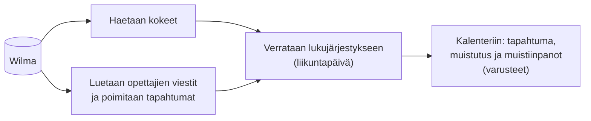
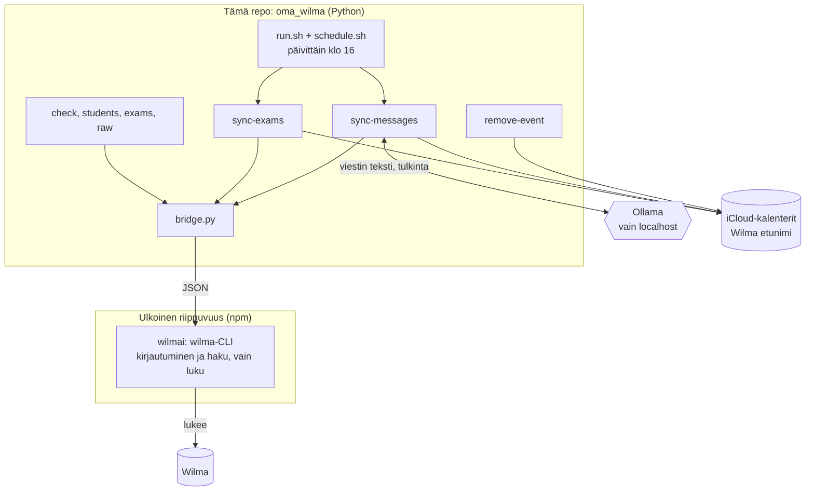
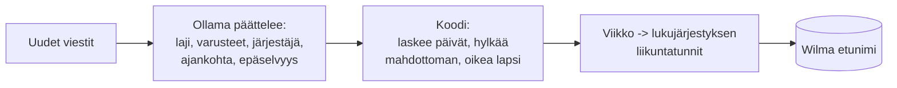

# Wilmaton Wilma

*Wilma without Wilma: the essentials show up in your calendar, so you rarely need to open it.* A small macOS tool that reads Wilma (Finnish school messaging system)
for exams and teachers' messages, interprets the messages with a local Ollama model, and puts the dates into your iCloud
calendar, one calendar per child. Messages never leave your machine. Unofficial; not affiliated with Visma. Docs are in Finnish.

Nimi on sanaleikki: oleelliset näkyvät kalenterissa, joten Wilmaa tarvitsee avata vähemmän. Koodi ja komennot ovat silti `oma_wilma`.

Vie Wilman **kokeet** ja **opettajien viesteissä kerrotut asiat** (liikunnan varusteet, kuvauspäivä, retki, tapahtumat)
iCloud-kalenteriisi muistutuksineen: yksi kalenteri `Wilma <etunimi>` lasta kohden. Wilmaa vain luetaan. Viestit tulkitsee **vain paikallinen Ollama** (omalla koneella pyörivä tekoäly),
eli viestin sisältö ei lähde koneelta. Tehty macOS:lle yksityiskäyttöön; ei liity Vismaan tai Wilmaan.

## Miksi ottaa käyttöön

Wilmassa on kaksi paikkaa, joita ei tule säännöllisesti kurkistettua. Kokeet löytyvät omasta Kokeet-osiostaan. Opettajien viesteistä moni
koskee jotain tiettyä päivää ("ensi viikolla luistelu, ota luistimet", "kuvauspäivä torstaina") ja hukkuu muun joukkoon. Tämä työkalu vie
ne puolestasi kalenteriin, jota katsot muutenkin.

- **Kaikki yhdessä paikassa:** kokeet ja viesteissä kerrotut asiat näkyvät kalenterissa.
- **Muistutus ajoissa:** kokeesta kaksi päivää etukäteen, varusteista edellisenä iltana. Otsikossa on tärkein (esim. `🎽Luistelu: luistimet`), loput muistiinpanoissa.
- **Liikunta osuu oikealle päivälle:** kun viesti sanoo vain "ensi viikolla", päivä haetaan lapsen lukujärjestyksen liikuntatunneilta.
- **Ei kuittausta lapsi kerrallaan:** Wilmassa sama viesti pitää kuitata käsin erikseen jokaiselle lapselle. Täällä usealle lapselle tuleva viesti käsitellään kerran.
- **Yksityinen:** viestit tulkitsee [Ollama](https://ollama.com), ohjelma, joka ajaa tekoälymallin (tässä Googlen Gemma) kokonaan omalla koneellasi. Malli ladataan kerran, minkä jälkeen tulkinta ei tarvitse nettiyhteyttä. Viestin teksti ei lähde koneelta; iCloud-kalenteriin menee vain tulkittu tapahtuma.



Hyvä tietää: Wilmaa vain luetaan, mutta viestin avaaminen voi merkitä sen Wilmassa luetuksi. Tekoäly erehtyy joskus, joten tärkeät asiat kannattaa tarkistaa alkuperäisestä viestistä.

**Kokeiden vienti kalenteriin on vielä testaamatta oikealla datalla:** kokeiden haun kuiva-ajo on tehty (Wilma vastasi ilman virheitä), mutta kokeita ei ole ollut tulossa. Odotamme koeviikkoa. Siihen asti kokeiden osuus on testattu vain keksityllä datalla.

## Rakenne

Wilma-haun tekee **ulkoinen kirjasto**, [wilmai](https://github.com/aikarjal/wilmai) ja sen `wilma`-CLI. Se asennetaan npm-riippuvuutena,
sen koodia ei ole tässä repossa, ja vain `bridge.py` kutsuu sitä.



| Riippuvuus | Mihin | Asennus |
|---|---|---|
| wilmai / wilma-CLI | Wilma-haku | `npm install` |
| pyobjc (EventKit) | kalenteriin kirjoitus | `pip install -r requirements.txt` |
| Ollama | viestien tulkinta | ollama.com, `ollama pull gemma4:12b` |

**Ollamasta:** asenna Ollama-sovellus (ollama.com) ja lataa malli kerran: `ollama pull gemma4:12b` (7,7 Gt levyä; testattu 16 Gt:n muistilla). Sovellus pitää
palvelimen käynnissä taustalla; ilman sovellusta sen voi käynnistää käsin: `ollama serve`. Ajastetussa ajossa `scripts/run.sh` käynnistää palvelimen
itse, jos se ei vastaa, joten erillistä automaattista käynnistystä ei tarvita.

## Asennus

```
npm install
cp .env.example .env                # WILMA_TENANT ja WILMA_USERNAME
cp config.example.toml config.toml  # henkilökohtaiset asetukset (lapset, järjestäjät, muistutukset)
python3 -m venv .venv && .venv/bin/pip install -r requirements.txt
security add-generic-password -s wilma -a password -w          # salasana Keychainiin (kysyy arvon)
security add-generic-password -s wilma -a totp-secret -w       # vain kaksivaiheisella; avain, ei 6 numeron koodi
```

Luo Kalenterit-sovelluksessa (iCloud) kalenteri jokaiselle lapselle nimellä `Wilma <etunimi>`. Työkalu ei luo niitä, ja jos jokin
puuttuu, ajo keskeytyy ennen kirjoitusta. Tarkistus: `python3 -m oma_wilma check`.

## Käyttö

```
.venv/bin/python -m oma_wilma sync-exams [--dry-run]      kokeet kalentereihin
.venv/bin/python -m oma_wilma sync-messages [--dry-run]   viestit kalentereihin (--days N, --student X, --again, --explain)
.venv/bin/python -m oma_wilma remove-event TUNNISTE       poistaa oman tapahtuman ([wilma:...] muistiinpanoissa)
python3 -m oma_wilma check | students | exams | raw ...   haku, vain luku

scripts/run.sh [--dry-run]                                 koko putki: kokeet, sitten viestit
scripts/schedule.sh on | off | status | test               päivittäinen ajastus (launchd)
```

`--dry-run` ei kirjoita mitään; viesteille se kertoo vain määrän. `--again --explain` käsittelee viestit uudelleen ja näyttää, mitä malli
ehdotti ja miksi jokin hylättiin (ei viestin tekstiä). **Viestin avaaminen voi merkitä sen Wilmassa luetuksi.**

## Mitä kalenteriin tulee

Otsikko mahtuu puhelimen näytölle (laji ja tärkein varuste); koko tieto, myös valinnaiset varusteet kuten maila, on muistiinpanoissa.

| Laji | Esimerkki | Muistutus |
|---|---|---|
| 📝 Koe | `📝Koe: Matematiikka – Murtoluvut` | 2 pv ennen |
| 🎽 Liikunta | `🎽Luistelu: luistimet` | edellisenä iltana |
| 📸 Kuvaus, 🚌 Retki, 📌 Tapahtuma | `📸Kuvaus: kuvauspäivä` | edellisenä iltana |
| 👪 Koulun vanhempainilta | `👪Vanhempainilta` | 3 pv ja 1 pv ennen |
| ℹ️ Tiedoksi (ulkopuolinen järjestäjä) | `ℹ️Tiedoksi: Seurakunta – ilta` | ei |

`⚠️` lajin emojin jälkeen tarkoittaa, että malli piti asiaa epäselvänä (syy on kuvauksessa). Tapahtumat ovat koko päivän tapahtumia.

## Miten viestit tulkitaan

Viestit ovat vapaamuotoisia, joten **malli päättelee merkityksen ja koodi hoitaa hallinnan**.



- **Malli:** luokka, otsikko, varusteet (pakolliset, valinnaiset, kielletyt), onko järjestäjä koulu, ajankohta (viikonpäivä, päiväys, viikko) ja epäselvyys. Lapsen omat viimeaikaiset merkinnät (poissaolot) annetaan sille, jotta se ratkaisee koskeeko ehdollinen viesti juuri tätä lasta.
- **Koodi:** laskee päivät viikosta ja viikonpäivästä, hylkää mahdottoman (ei ajankohtaa, mennyt, yli 90 pv), hyväksyy tarkan päivän vain jos viesti mainitsee sen, ja varmistaa oikean lapsen kalenterin.
- **Viikkoon sidottu liikunta** sijoitetaan oppilaan lukujärjestyksen liikuntatunneille; viestissä nimetty päivä menee sille päivälle.
- **Sisarukset:** sama viesti usealle lapselle käsitellään kerran ja menee `shared_priority`-listan ensimmäiselle. Lapsia voi olla kolme, neljä tai useampi: listaan voi laittaa kaikki, ja tapahtuman otsikossa on aina sama 👬-merkki sekä kuvauksessa lista muista lapsista, joille viesti tuli.
- **Toisto ei tuplaa:** tapahtuman tunniste on oppilas, laji ja päivä; saman päivän eri viestit yhdistetään, ja uudelleenkäsitelty viesti korvaa oman vanhan osuutensa.

## Asetukset ja turvarajat

`config.toml` (ei Gitissä): `[ollama]` osoite ja malli, `[messages]` `shared_priority`, `external_organizers`, `pe_subject_words`, `[reminders]`
kellonaika ja päivät. Salasanat ovat Keychainissa.

- Ollama hyväksytään vain osoitteesta `localhost`; viestin tekstiä ei kirjata mihinkään.
- Kalenteriin kirjoitetaan vain `Wilma `-alkuisiin kalentereihin, ja jokainen tapahtuma tarkistetaan oikean lapsen kalenteriin ennen kirjoitusta.
- `.env`, `config.toml`, `data/` ja `.private-terms.txt` eivät mene Gitiin. Aja ennen pushia `python3 scripts/privacy_check.py` (`--history` myös historia).

## Ylläpito

```
python3 -m unittest discover -s tests -t .      testit (eivät koske Wilmaan, kalenteriin tai Ollamaan)
scripts/update-wilmai.sh [latest]               päivittää wilmai-CLI:n ja ajaa testit
```

Koodin rakenne: `oma_wilma/` (`bridge`, `models`, `sync_exams`, `sync_messages`, `prompt`, `notices`, `when`, `notice_events`, `calendars`, `calendar_export`).

**Epävirallinen työkalu.** Wilman käyttöehtoja ei ole varmistettu tälle käytölle; käytä omalla vastuullasi ja omilla tunnuksillasi, vain omien lasten tietoihin.

## Windows (ei testattu)

Työkalu on tehty macOS:lle eikä sitä ole testattu Windowsissa, eikä sitä aiota testata. Karkea suunta niille, jotka haluavat kokeilla:
Wilma-haku (wilmai), Python-koodi ja Ollama toimivat sellaisinaan myös Windowsissa. macOS-sidonnaiset osat pitää korvata:
kalenteriin kirjoitus (`calendar_export.py`, EventKit/pyobjc; esim. Outlook tai Google Calendar -rajapinta tai `.ics`-tiedostot),
salasanat (macOS Keychain; esim. Windowsin Credential Manager tai ympäristömuuttujat) ja ajastus (`launchd`; esim. Windowsin
Tehtävien ajoitus (Task Scheduler), jolla ajetaan `scripts/run.sh`:n vastine).

## Lisenssi

[MIT](LICENSE). Wilma-haun tekee [wilmai](https://github.com/aikarjal/wilmai) (`@wilm-ai/wilma-cli`, MIT, © Wilm.ai), joka asennetaan
npm-riippuvuutena eikä sisälly tähän repoon.
