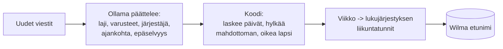
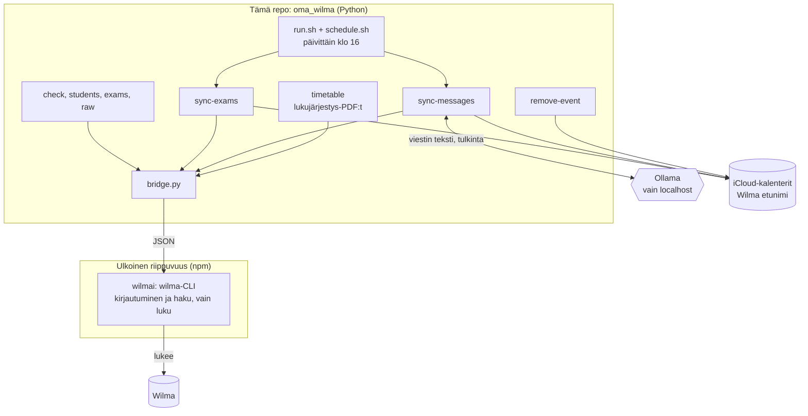

# Tekninen kuvaus

Yleiskuva ja käyttöönotto: [README](../README.md). Lukujärjestyksen valinnat: [lukujarjestys.md](lukujarjestys.md).

## Komennot

**Kalenteri**

```
scripts/run.sh [--dry-run]                                 koko putki: kokeet, sitten viestit
scripts/schedule.sh on | off | status | test               päivittäinen ajastus (launchd)
.venv/bin/python -m oma_wilma sync-exams [--dry-run]      kokeet kalentereihin
.venv/bin/python -m oma_wilma sync-messages [--dry-run]   viestit kalentereihin (--days N, --student X, --again, --explain)
.venv/bin/python -m oma_wilma remove-event TUNNISTE       poistaa oman tapahtuman ([wilma:...] muistiinpanoissa)
```

`--dry-run` ei kirjoita mitään; viesteille se kertoo vain määrän. `--again --explain` käsittelee viestit uudelleen ja näyttää, mitä malli
ehdotti ja miksi jokin hylättiin (ei viestin tekstiä). **Viestin avaaminen voi merkitä sen Wilmassa luetuksi.**

**Lukujärjestys**

```
scripts/timetable.sh [valinnat]                            lukujärjestykset PDF:ksi (data/lukujarjestykset/)
scripts/timetable.sh --help                                kaikki valinnat
```

**Yhteiset (vain luku)**

```
python3 -m oma_wilma check | students | exams | raw ...   kirjautumisen tarkistus ja haku
```

## Ajastus

Vain kalenterivienti ajastetaan (macOS:n launchd); lukujärjestykset tehdään käsin.

```
scripts/schedule.sh on        ajastus päälle
scripts/schedule.sh test      ajaa heti ajastuksen kautta ja näyttää lokin: varmista tällä, että ajastus toimii
scripts/schedule.sh status    onko päällä, viimeisin onnistunut ajo ja lokin loppu
scripts/schedule.sh off       ajastus pois
```

- **Milloin ajetaan:** joka päivä klo 16 sekä kirjautuessa. Kirjautumisajo ohitetaan, jos ajo on jo onnistunut: ennen klo 16
  saman päivän aikana, klo 16 jälkeen kello 16:n jälkeen. Näin väliin jäänyt ajo (kone sammutettuna) tehdään seuraavalla
  kirjautumisella. Epäonnistunut ajo yritetään uudelleen seuraavalla kerralla.
- **Loki:** `data/run.log`.
- **Kellonajan vaihto:** muuta tunti sekä tiedostossa `launchd/fi.wilma.daily.plist.template` että `scripts/run.sh`:n
  `--if-due`-kohdassa, ja aja `scripts/schedule.sh on`.
- **Jos siirrät projektikansion**, aja `scripts/schedule.sh on` uudelleen: ajastukseen tallentuu kansion polku.

## Miten viestit tulkitaan

Viestit ovat vapaamuotoisia, joten **malli päättelee merkityksen ja koodi hoitaa hallinnan**.



- **Malli:** luokka, otsikko, varusteet (pakolliset, valinnaiset, kielletyt), onko järjestäjä koulu, ajankohta (viikonpäivä, päiväys, viikko) ja epäselvyys. Lapsen omat viimeaikaiset merkinnät (poissaolot) annetaan sille, jotta se ratkaisee koskeeko ehdollinen viesti juuri tätä lasta.
- **Koodi:** laskee päivät viikosta ja viikonpäivästä, hylkää mahdottoman (ei ajankohtaa, mennyt, yli 90 pv), hyväksyy tarkan päivän vain jos viesti mainitsee sen, ja varmistaa oikean lapsen kalenterin.
- **Viikkoon sidottu liikunta** sijoitetaan oppilaan lukujärjestyksen liikuntatunneille; viestissä nimetty päivä menee sille päivälle.
- **Sisarukset:** sama viesti usealle lapselle käsitellään kerran ja menee `shared_priority`-listan ensimmäiselle. Lapsia voi olla kolme, neljä tai useampi: listaan voi laittaa kaikki, ja tapahtuman otsikossa on aina sama 👬-merkki sekä kuvauksessa lista muista lapsista, joille viesti tuli.
- **Toisto ei tuplaa:** tapahtuman tunniste on oppilas, laji ja päivä; saman päivän eri viestit yhdistetään, ja uudelleenkäsitelty viesti korvaa oman vanhan osuutensa.

## Rakenne

Wilma-haun tekee **ulkoinen kirjasto**, [wilmai](https://github.com/aikarjal/wilmai) ja sen `wilma`-CLI. Se asennetaan npm-riippuvuutena,
sen koodia ei ole tässä repossa, ja vain `bridge.py` kutsuu sitä.



| Riippuvuus | Mihin | Asennus |
|---|---|---|
| wilmai / wilma-CLI | Wilma-haku | `npm install` |
| pyobjc (EventKit) | kalenteriin kirjoitus | `pip install -r requirements.txt` |
| Ollama | viestien tulkinta | ollama.com, `ollama pull gemma4:12b` |

**Ollamasta:** asenna Ollama-sovellus (ollama.com) ja lataa malli kerran: `ollama pull gemma4:12b` (7,7 Gt levyä; testattu 16 Gt:n muistilla). Sovellus pitää
palvelimen käynnissä taustalla; ilman sovellusta sen voi käynnistää käsin: `ollama serve`. Ajastetussa ajossa `scripts/run.sh` käynnistää palvelimen
itse, jos se ei vastaa, joten erillistä automaattista käynnistystä ei tarvita.

## Asetukset ja turvarajat

`config.toml` (ei Gitissä): `[ollama]` osoite ja malli, `[messages]` `shared_priority`, `external_organizers`, `pe_subject_words`, `[reminders]`
kellonaika ja päivät, `[timetable]` ruokatauko, tukiopetuksen sanat ja aineiden nimet. Salasanat ovat Keychainissa.

- Ollama hyväksytään vain osoitteesta `localhost`; viestin tekstiä ei kirjata mihinkään.
- Kalenteriin kirjoitetaan vain `Wilma `-alkuisiin kalentereihin, ja jokainen tapahtuma tarkistetaan oikean lapsen kalenteriin ennen kirjoitusta.
- `.env`, `config.toml`, `data/` (myös lukujärjestys-PDF:t) ja `private/` (omat muistiinpanot ja yksityisyystarkistuksen sanalista
  `private/private-terms.txt`: lasten nimet ym.) eivät mene Gitiin. Aja ennen pushia `python3 scripts/privacy_check.py` (`--history` myös historia).

## Ylläpito

```
python3 -m unittest discover -s tests -t .      testit, kalenteri ja lukujärjestys (eivät koske Wilmaan, kalenteriin, Ollamaan tai Chromeen)
scripts/update-wilmai.sh [latest]               päivittää wilmai-CLI:n ja ajaa testit
```

Koodin rakenne (`oma_wilma/`), kalenteri ja lukujärjestys erillään; ne jakavat vain yhteiset osat:

| Kansio | Mitä | Moduulit |
|---|---|---|
| `oma_wilma/` | yhteiset: asetukset, Wilma-haku, oma tietomuoto, komentorivi | `config`, `bridge`, `models`, `__main__` |
| `oma_wilma/calendar_sync/` | kalenteri: kokeet ja viestit iCloud-kalentereihin | `sync_exams`, `sync_messages`, `messages`, `prompt`, `notices`, `when`, `notice_events`, `events`, `calendars`, `calendar_export` ym. |
| `oma_wilma/timetable/` | lukujärjestys: tunnit PDF:ksi teemalla | `grid` (ruudukko), `pdf` (sivu ja PDF), `themes` (teemat) |

## Windows (ei testattu)

Työkalu on tehty macOS:lle eikä sitä ole testattu Windowsissa, eikä sitä aiota testata. Karkea suunta niille, jotka haluavat kokeilla:
Wilma-haku (wilmai), Python-koodi ja Ollama toimivat sellaisinaan myös Windowsissa. macOS-sidonnaiset osat pitää korvata:
kalenteriin kirjoitus (`calendar_sync/calendar_export.py`, EventKit/pyobjc; esim. Outlook tai Google Calendar -rajapinta tai `.ics`-tiedostot),
salasanat (macOS Keychain; esim. Windowsin Credential Manager tai ympäristömuuttujat) ja ajastus (`launchd`; esim. Windowsin
Tehtävien ajoitus (Task Scheduler), jolla ajetaan `scripts/run.sh`:n vastine).
